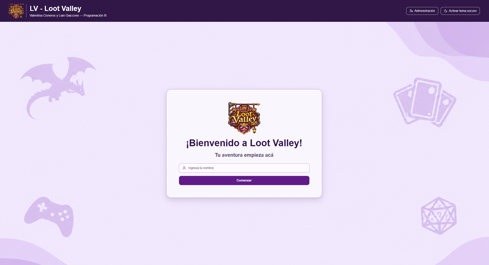
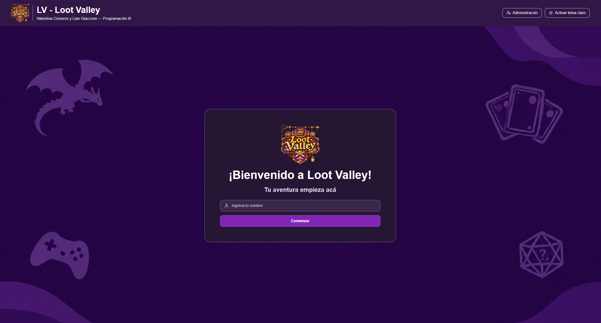
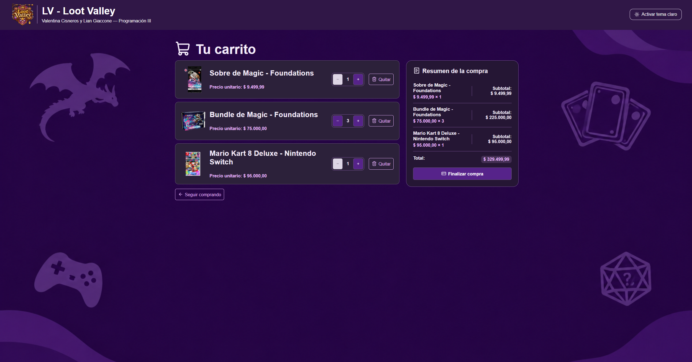
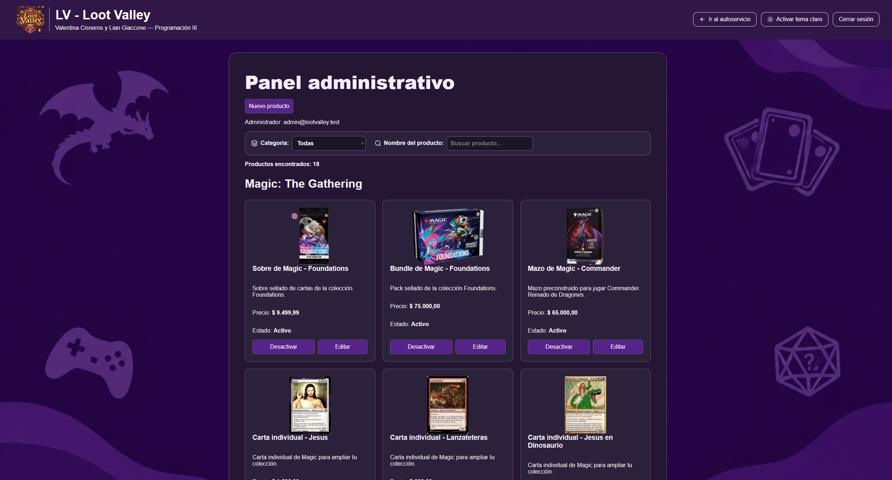
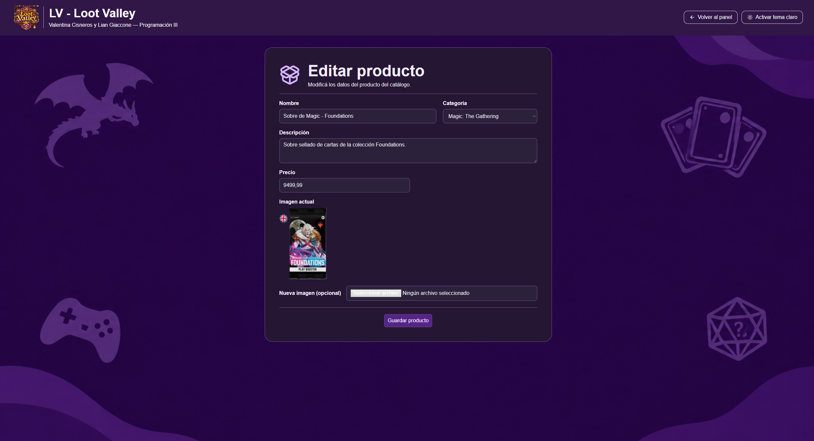

# LV – Loot Valley

Loot Valley es una aplicación web de autoservicio desarrollada como Trabajo Práctico Integrador de Programación III de la Tecnicatura Universitaria en Programación de la UTN Facultad Regional Avellaneda.

El sistema simula una tienda de productos de Magic: The Gathering y videojuegos, integrando una interfaz de compra para clientes y un panel de gestión para administradores.

## Funcionalidades

### Clientes

- Identificación del cliente.
- Visualización del catálogo de productos.
- Búsqueda por nombre y filtrado por categoría.
- Paginación de productos.
- Gestión del carrito de compras.
- Registro de ventas.
- Generación y descarga de tickets en PDF.

### Administradores

- Inicio y cierre de sesión.
- Autenticación mediante JWT.
- Panel administrativo.
- Alta y modificación de productos.
- Activación y desactivación de productos.
- Carga de imágenes.
- Gestión del catálogo.

## Capturas de la aplicación

### Experiencia del cliente

#### Pantalla de bienvenida

La aplicación dispone de un modo claro y un modo oscuro.

| Modo claro | Modo oscuro |
| --- | --- |
|  |  |

#### Catálogo de productos

#### Carrito de compras

### Panel de administración

#### Gestión del catálogo

#### Creación y edición de productos

## Tecnologías utilizadas

| Área | Tecnologías |
| --- | --- |
| Frontend | HTML5, CSS3, JavaScript |
| Backend | Node.js, Express.js |
| Plantillas dinámicas | EJS |
| Base de datos | MySQL |
| ORM | Sequelize |
| Conexión con la base de datos | mysql2 |
| Autenticación | JSON Web Token (JWT), cookie-parser |
| Hash de contraseñas | bcrypt |
| Carga de archivos | Multer |
| Generación de PDF | Puppeteer |
| Variables de entorno | dotenv |
| Control de versiones | Git y GitHub |

## Arquitectura

El proyecto utiliza una arquitectura cliente-servidor, separando la interfaz de usuario, la lógica de negocio y la persistencia de datos.

El frontend se comunica con el backend mediante una API REST. El backend organiza sus responsabilidades mediante rutas, controladores, middlewares y modelos.

### Estructura del proyecto

    tp-integrador-programacion-3/
    ├── backend/
    │   ├── config/
    │   ├── controllers/
    │   ├── middlewares/
    │   ├── models/
    │   ├── routes/
    │   ├── scripts/
    │   ├── Utils/
    │   ├── views/
    │   ├── .env.example
    │   ├── index.js
    │   └── package.json
    ├── frontend/
    │   ├── css/
    │   ├── img/
    │   ├── js/
    │   ├── index.html
    │   ├── productos.html
    │   ├── carrito.html
    │   └── ticket.html
    ├── .gitignore
    └── README.md

## Base de datos

La aplicación utiliza una base de datos relacional MySQL gestionada mediante Sequelize. Los modelos principales son:

- Categoría
- Producto
- Venta
- DetalleVenta
- Usuario

Las ventas y sus detalles se registran mediante transacciones para mantener la consistencia de los datos.

## Autenticación y validaciones

- Contraseñas almacenadas mediante hashing con bcrypt.
- Autenticación de administradores mediante JWT.
- Almacenamiento del token en una cookie HttpOnly.
- Protección de rutas administrativas mediante middlewares.
- Validación de datos recibidos por el servidor.
- Configuración de credenciales mediante variables de entorno.
- Cálculo de los importes de venta desde el backend.

## Autores

Proyecto desarrollado en equipo por:

- [Valentina Cisneros](https://github.com/valee-cns)
- [Lian Leonel Giaccone](https://github.com/Lian-Giaccone)

## Contexto académico

- Universidad: UTN Facultad Regional Avellaneda.
- Carrera: Tecnicatura Universitaria en Programación.
- Materia: Programación III.
- Comisión: 333.
- Año: 2026.
